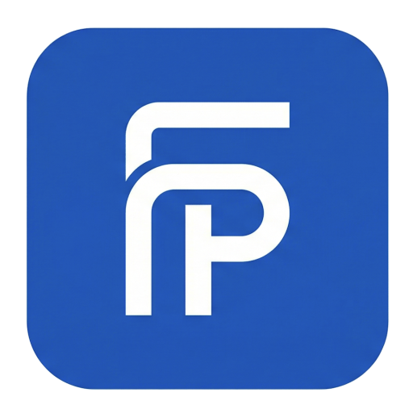

  

  
  
  

Estudiante de **DAM**, titulado en **Sistemas Microinformáticos y Redes** y creador de **FideliPass**. Construyo aplicaciones, integro APIs y automatizo tareas reales.

📍 **Málaga / remoto** · Busco prácticas u oportunidades junior en **backend y desarrollo de aplicaciones**.

## Mis proyectos

<table>
  <tr>
    <td align="center" width="120"></td>
    <td>
      <h3>FideliPass · SaaS de fidelización</h3>
      
Tarjetas digitales para <b>Apple Wallet y Google Wallet</b>: QR, sellos, puntos y recompensas para que los clientes vuelvan al comercio.

      
<b>Producto en activo · Captando comercios</b> <a href="https://fidelipass.es"><b>Conoce FideliPass →</b></a>

    </td>
  </tr>
</table>

<table>
  <tr>
    <td align="center" width="120"></td>
    <td>
      <h3>Canvas Assistant · Tu clase, en Telegram</h3>
      
Tareas, recordatorios y entregas con confirmación, sin salir del chat. Creado para una práctica de clase.

      
<b>Python · Cloudflare Workers · D1</b> <a href="https://github.com/ItzAbra26/canvas-telegram-assistant"><b>Explora el proyecto →</b></a>

    </td>
  </tr>
</table>

  

<table>
  <tr>
    <td align="center" width="120"></td>
    <td>
      <h3>Retech.IA · Del edificio a su red</h3>
      
API que calcula subredes y propone infraestructura. Inspirada en mi proyecto ganador de hackathon.

      
<b>Java · Spring Boot · Redes</b> <a href="https://github.com/ItzAbra26/RetechIA"><b>Explora el proyecto →</b></a>

    </td>
  </tr>
</table>

## Mi stack

  
  
  
  
  
  

<picture>
  <source media="(prefers-color-scheme: dark)" srcset="https://raw.githubusercontent.com/ItzAbra26/ItzAbra26/output/github-snake-dark.svg" />
  <source media="(prefers-color-scheme: light)" srcset="https://raw.githubusercontent.com/ItzAbra26/ItzAbra26/output/github-snake.svg" />
  
</picture>
