  

  
  
  

## Desarrollo software con una base en sistemas y redes

Soy **Abraham Amar**, estudiante de **Desarrollo de Aplicaciones Multiplataforma (DAM)** y titulado en **Sistemas Microinformáticos y Redes**. Me interesa conectar el desarrollo de aplicaciones con la infraestructura que las hace funcionar.

Busco **prácticas de DAM o una primera oportunidad junior**, especialmente en **backend o desarrollo móvil**, en **Málaga o remoto**.

- **Mi enfoque:** Java, SQL, integración de APIs y automatización de tareas reales.
- **Mi base:** sistemas, redes, servidores y resolución de problemas.
- **Mi siguiente paso:** seguir profundizando en Spring, Android, Kotlin y Firebase.
- **Un logro:** ganador de un hackathon con **Retech.IA**, una propuesta que une IA e infraestructura.

## Proyectos destacados

### 01 / Canvas Telegram Assistant
**Una necesidad de clase convertida en una herramienta práctica.**

Asistente de **Canvas LMS por Telegram**, desarrollado como práctica para una clase de 15 alumnos. Permite consultar tareas, recibir avisos y preparar entregas desde el chat.

- Integra las APIs oficiales de **Canvas y Telegram**.
- Combina **Python, Cloudflare Workers, D1 y GitHub Actions**.
- Conserva credenciales y estado cifrados, con datos separados por alumno.
- Requiere confirmación antes de entregar archivos e incluye preparación de PDF y ZIP.

**Qué muestra:** integración de servicios, automatización, persistencia y atención a la experiencia de uso.

[**Ver código, arquitectura y pruebas →**](https://github.com/ItzAbra26/canvas-telegram-assistant)

Proyecto docente en modo de prueba; el paso a uso multiusuario de producción requiere OAuth.

  

### 02 / Retech.IA
**Backend y redes en un mismo proyecto.**

MVP técnico inspirado en la propuesta ganadora del hackathon **Retech.IA**: ayudar a planificar la infraestructura de edificios.

- API REST con **Java 21 y Spring Boot**.
- Cálculo de subredes y validación de requisitos por departamento.
- Propuesta inicial de equipamiento y estructura de red.
- Pruebas unitarias de la lógica de subnetting.

**Qué muestra:** lógica de negocio, diseño de APIs y aplicación de conocimientos de sistemas. La integración de IA forma parte del roadmap.

[**Explorar el repositorio →**](https://github.com/ItzAbra26/RetechIA)

### 03 / FideliPass
**Fidelización y gestión de usuarios en una aplicación.**

Aplicación orientada a gestionar programas de fidelización y usuarios, con **Java y SQL**. El proyecto conecta la organización de la información de clientes con una experiencia de uso pensada para la fidelización.

**Enfoque del proyecto:** gestión de datos, lógica de aplicación y experiencia de usuario.

## Tecnologías

**Con las que estoy construyendo y practicando**

  
  
  
  
  
  
  
  

**También he trabajado con:** JavaScript, PHP, HTML y CSS. 
**En aprendizaje:** Android, Kotlin y Firebase.

## Un poco de movimiento

Una serpiente recorre mi gráfico de contribuciones. La animación se regenera diariamente con GitHub Actions.

<picture>
  <source media="(prefers-color-scheme: dark)" srcset="https://raw.githubusercontent.com/ItzAbra26/ItzAbra26/output/github-snake-dark.svg" />
  <source media="(prefers-color-scheme: light)" srcset="https://raw.githubusercontent.com/ItzAbra26/ItzAbra26/output/github-snake.svg" />
  
</picture>

Animación generada con [Platane/snk](https://github.com/Platane/snk). [Ver ejecución automática](https://github.com/ItzAbra26/ItzAbra26/actions/workflows/snake.yml).

## ¿Hablamos?

Si tu equipo busca un perfil junior con interés en **backend, aplicaciones y sistemas**, me encantará conocer la oportunidad.

**[abrahamamar26@gmail.com](mailto:abrahamamar26@gmail.com)** · **[LinkedIn](https://www.linkedin.com/in/abraham-amar-bentolila-61bb75277/)**

Aprender, construir y mejorar. Proyecto a proyecto.

